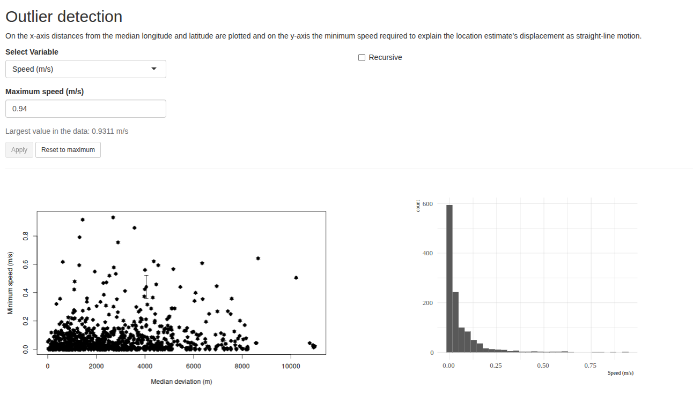

# Detect Outliers

MoveApps

GitHub repository: https://github.com/movestore/ctmm_outlier

  

## Description
This app removes relocations that are likely outliers based on a user-selected
maximum speed or distance. Based on the `outlie()` function of the ctmm
package.

## Documentation
This Shiny App uses `ctmm::outlie()` to calculate the distance from the
animal's median location and the minimum speed needed to explain the
relocation's displacement as straight-line motion, accounting for telemetry
error.

The App shows ctmm's outlier plot and a histogram of values for either
distance or speed. The user enters a maximum value for the selected variable.
Relocations above the maximum are removed from the output data and the App's
plots.

### Application scope
#### Generality of App usability
This App was developed for any taxonomic group.

#### Required data properties
The App should work for any kind of location data that can be converted to a
`ctmm` `telemetry` object.

### Input type
`ctmm::telemetry.list`

### Output type
`ctmm::telemetry.list`

### Artefacts
none

### Settings
**Select Variable**: The variable used for filtering: speed (m/s) or distance
from the median location (m). Default: speed.

**Recursive**: If checked, filtering is done recursively. That is, each time
a relocation is removed, the speed is re-estimated using the remaining points.
Any newly-calculated speeds that also exceed the input threshold are then
removed, and so on until no speeds exceed the threshold. This option is only
available when filtering on speed.

**Maximum speed / Maximum distance**: The largest value of the selected
variable to retain in the data. Relocations above this value are removed once
the **Apply** button is clicked. By default no points are removed.

**Apply**: Click this button to filter the data using the currently entered
**Maximum speed** or **Maximum distance**. The button is shown in blue when
the value in the **Maximum speed** or **Maximum distance** box is yet to be
applied.

**Reset to maximum**: Set the cutoff back to the default value for the
selected variable and apply it. This re-adds all points that had been removed.

**Store settings**: click to store the current settings of the app for future
workflow runs.

### Changes in output data
The App filters the input data based on the maximum entered by the user.
Relocations above the maximum are removed from the output. Any animals that
have no locations at or below the maximum are removed from the output
entirely.

### Errors and null handling
**Animals with no relocations at or below the maximum:** if all relocations of
an animal are removed, the animal is removed from the output. The App displays a
note and produces a warning when any animals are excluded in this way. If no
animals include any points at or below the maximum, neither plot is displayed
and the app returns no data.

### Technical details
- Speed and distance are calculated per animal with `ctmm::outlie()`. See its
  documentation for how they are estimated:
  [outlie()](https://ctmm-initiative.github.io/ctmm/reference/outlie.html).
- With **Recursive**, `outlie()` is rerun after each round of removals, so the
  speeds used for filtering and in the plots are those of the remaining data.
- Speeds are shown in m/s and distances in m, in both the input and the plots.
- The output always reflects the settings that were most recently applied, not
  necessarily those that are currently displayed in the input boxes.

The outlier statistics are described in Fleming, C. H., et al. (2020). A
comprehensive framework for handling location error in animal tracking data.
*bioRxiv*. https://doi.org/10.1101/2020.06.12.130195

The `ctmm` package is described in Calabrese, J. M., Fleming, C. H., &
Gurarie, E. (2016). ctmm: An R package for analyzing animal relocation data as
a continuous-time stochastic process. *Methods in Ecology and Evolution*,
7(9), 1124–1132. https://doi.org/10.1111/2041-210X.12559
